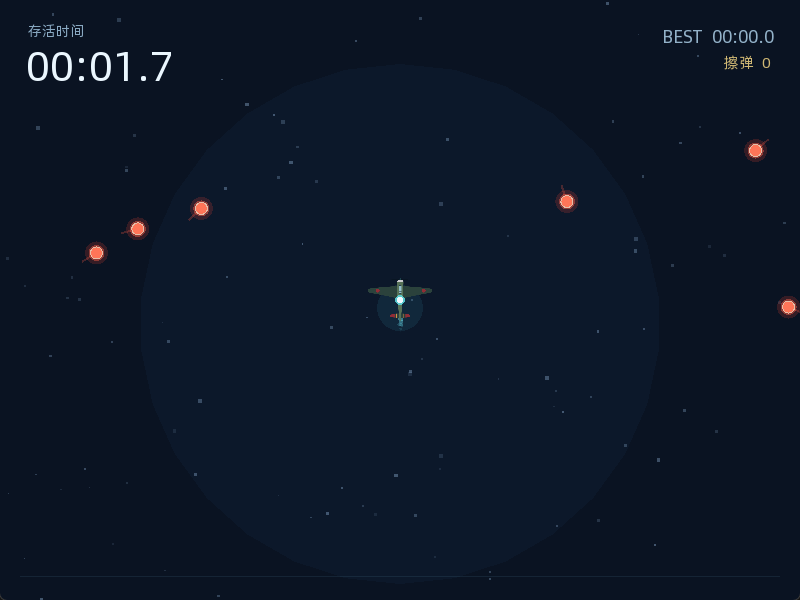

# airwar

**是男人就撑过 30 秒（简陋重置版）**

一个使用 C++17、CMake 和 SFML 制作的小型弹幕生存游戏。控制飞机躲避不断加速的弹幕，生存越久，评价越高。



## 玩法

- 存活时间越长，子弹生成越快、数量越多
- 高速子弹会在后期出现，并带有黄色高亮
- 贴近子弹可触发擦弹评价：漂亮、擦弹、惊险、完美闪避
- 生存 30 秒会触发里程碑提示
- 根据存活时间、擦弹次数和擦弹质量给出 S/A/B/C/D/E 评级与综合评分
- 最佳成绩保存在可执行文件目录的 `best_time.txt`

## 操作

| 按键 | 功能 |
| --- | --- |
| `WASD` / 方向键 | 移动飞机 |
| `Enter` / `Space` | 开始游戏、继续、死亡后重新开始 |
| `Esc` | 暂停 / 继续 / 退出 |
| `R` | 死亡后快速重开 |

## 下载

前往 [Releases](https://github.com/0cch/airwar/releases) 下载最新的 Windows 或 Linux 构建。

- Windows：解压 `airwar-windows-x64.zip` 后运行 `airwar.exe`
- Linux：解压 `airwar-linux-x64.tar.gz` 后运行 `airwar`

发布包内已包含运行时需要的 `plane.png` 和 `font.ttf`。

## 从源码构建

### 依赖

- CMake 3.16+
- 支持 C++17 的编译器
- 首次配置时需要联网下载 SFML 2.6.2

### Windows

```powershell
cmake -S . -B build -G "Visual Studio 17 2022" -A x64
cmake --build build --config Release --parallel
```

可执行文件位于 `build/bin/Release/airwar.exe`。CMake 会自动把 `plane.png` 和 `font.ttf` 复制到可执行文件目录。

### Linux

```bash
sudo apt-get update
sudo apt-get install -y \
  libx11-dev libxrandr-dev libxcursor-dev libxi-dev \
  libudev-dev libgl1-mesa-dev libfreetype6-dev

cmake -S . -B build -DCMAKE_BUILD_TYPE=Release
cmake --build build --parallel
```

可执行文件位于 `build/bin/airwar`。运行前请确保 `plane.png` 和 `font.ttf` 位于可执行文件目录或当前工作目录。

## 自动发布

GitHub Actions 工作流位于 `.github/workflows/release.yml`。

推送符合 `v*` 格式的 tag 时，会自动：

1. 构建 Windows x64 版本
2. 构建 Linux x64 版本
3. 打包运行所需资源
4. 创建或更新对应的 GitHub Release

示例：

```bash
git tag v1.0.0
git push origin v1.0.0
```

## 项目结构

```text
main.cpp         游戏、渲染、输入与界面
CMakeLists.txt   构建配置，使用 FetchContent 获取 SFML
plane.png        玩家飞机贴图
font.ttf         中文界面字体
image.png        项目预览图
```

## 范围说明

本仓库仅包含 SFML 桌面版。微信小游戏 / Cocos 移植版本不包含在本仓库中。

## License

MIT，详见 [LICENSE](LICENSE)。